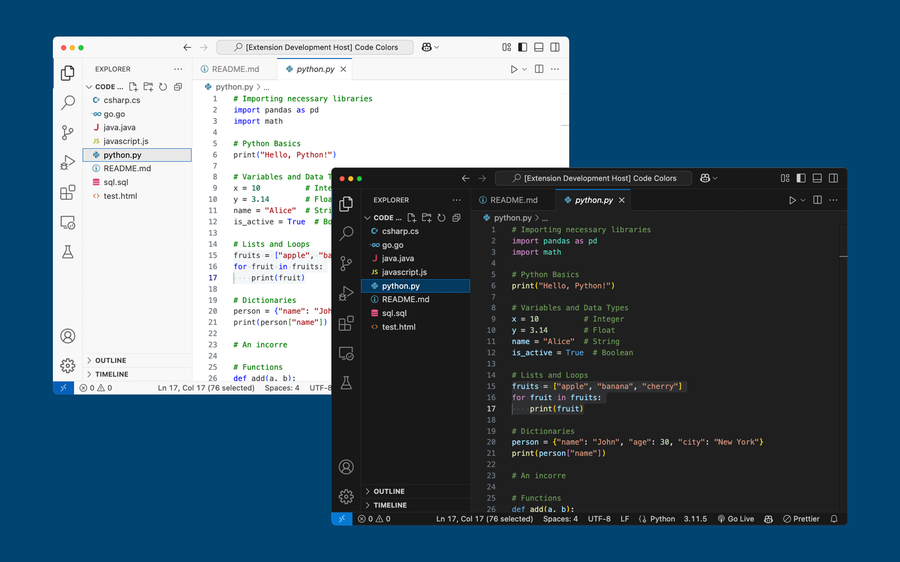

# LinkedIn Learning VS Code Theme (Light/Dark)

Accessible light and dark variant theme for VS Code created to improve accessibility when displaying code in LinkedIn Learning courses and in GitHub Codespaces. The dark variant is the default theme used for LinkedIn Learning exercise files and Codespaces.

These themes are designed with readability in mind. Contrast varies by syntax token and UI element; they are not certified to meet WCAG AAA throughout.

## Install

1. Go to [VS Marketplace](https://marketplace.visualstudio.com/items?itemName=linkedinlearning.linkedinlearning-vscode-theme).
2. Click on the "Install" button.
3. Then [select a theme](https://code.visualstudio.com/docs/getstarted/themes#_selecting-the-color-theme). The options are:
   - `LinkedIn Learning Dark (Default)`
   - `LinkedIn Learning Light`

Installing the extension does not change your selected theme automatically.

## Contributing

See [CONTRIBUTING.md](CONTRIBUTING.md) for development, theme previews, and release instructions.
